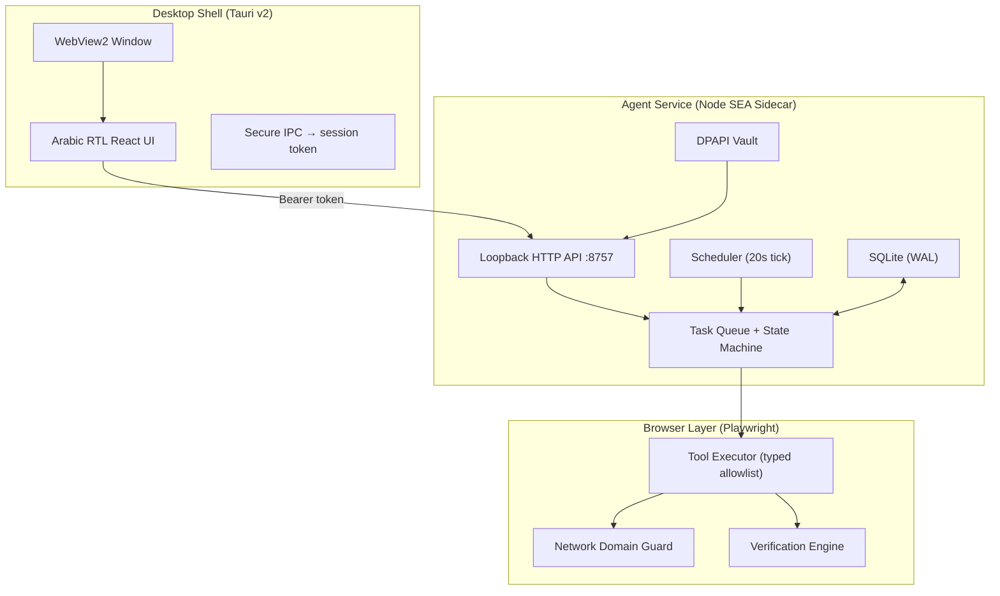

<div align="center">

# AI Repeat

**Teach it your work once, let it run with you.**

An Arabic-first, local-first desktop AI coworker that teaches recurring browser tasks and re-runs them in an app-owned browser — without touching the user's real mouse — and verifies every outcome with deterministic checks.

[](https://github.com/ahmed-makram-alsaidy/ai-repeat/actions/workflows/ci.yml)
[](LICENSE)
[]()
[]()
[]()

[العربي](#arabic) · [Architecture](#architecture) · [Screenshots](#screenshots) · [Quick Start](#quick-start) · [Safety](#safety-model) · [Contributing](CONTRIBUTING.md)

</div>

---

## ✨ What it does

| | |
|---|---|
| 🎓 **Teach** | Record a browser task once (or describe it in Arabic and let AI draft it) |
| ▶️ **Run** | Re-execute in an app-owned Chromium browser — never touches your mouse |
| ✅ **Verify** | 5 deterministic assertion types — independent of any LLM claim |
| 🛡️ **Approve** | External actions pause and wait for your explicit fingerprint-bound consent |
| ⏰ **Schedule** | Interval or daily recurring — through the same approval pipeline |
| 🌍 **i18n** | Arabic RTL + English LTR toggle |

<div align="center">

### 🏠 Home Dashboard


### ✅ Task Completed — Verification Report


### 📋 Task Detail — Steps + CSV Preview


### 🛠 Skills — Schedule + Version History


### ⚙️ Settings — STT Engine + Voice


### 📝 Execution Log — Audit Trail


</div>

---

## 🏗 Architecture



> Full diagrams: [docs/diagrams/ARCHITECTURE.md](docs/diagrams/ARCHITECTURE.md)

## 🛡 Safety Model

```
Layer 1: Input Validation
  ├─ Zod Schema (closed allowlist, 9 typed actions)
  ├─ Path Sandbox (traversal/absolute blocked)
  └─ Action Fingerprint (SHA-256, mutation → fresh consent)

Layer 2: Execution Guards
  ├─ Network Guard (abort non-allowlisted domains in-browser)
  ├─ Secret Guard (password/OTP never filled or recorded)
  ├─ Approval Gate (external_write/high_impact → fingerprint-bound pause)
  └─ Token Budget (per-run cap from provider-reported usage)

Layer 3: Output Redaction
  ├─ redactValue on every DB write
  ├─ Event log redaction at write time
  └─ Backup export with explicit contents disclosure
```

## 🚀 Quick Start

### Desktop App

```bash
git clone https://github.com/ahmed-makram-alsaidy/ai-repeat.git
cd ai-repeat
npm install
npx playwright install chromium
npm run app          # Tauri dev mode (spawns agent automatically)
npm run app:build    # NSIS installer
```

### Browser-only Dev Mode

```bash
npm install
npm run build
npm run agent        # Start agent + fixture site + serve UI at :8757
```

### Tests

```bash
npx vitest run       # Fast suite (73 tests, no browser)
npm run test:e2e     # Heavy E2E suite (real Chromium)
npm run smoke        # Offline demo through real executor
```

## 📦 Build from source

| Command | Output |
|---|---|
| `npm run app:build` | NSIS installer (`AI Repeat_0.1.0_x64-setup.exe`) |
| `npm run agent:sidecar` | Standalone agent binary (Node SEA) |
| `npm run smoke` | Offline demo through real executor |

## 📂 Repository Layout

```
packages/contracts/    Zod schemas: workflow, tasks, events, schedules
packages/security/     Domain allowlist, path sandbox, redaction, fingerprints
packages/llm/          Provider adapters (OpenAI-compatible, mock, offline)
packages/workflows/    Browser executor, verification, recorder, orphan cleanup
services/agent/        Loopback API, task queue, SQLite, DPAPI vault, scheduler
apps/desktop/          Tauri v2 shell + Arabic RTL React UI (Vite)
fixtures/demo-site/    Deterministic fixture web server
tests/                 Fast unit tests (no Chromium needed)
tests/e2e/             Heavy E2E tests (real browser)
docs/                  Shipping report, user guide, pilot plan, diagrams
```

## 🌍 Arabic Resources

| | |
|---|---|
| **دليل المستخدم** | [docs/USER_GUIDE.md](docs/USER_GUIDE.md) — خطوة بخطوة بالعربي |
| **خطة الـpilot** | [docs/PILOT_PLAN.md](docs/PILOT_PLAN.md) — 5–10 مستخدمين و4 أسابيع |
| **تقرير الشحن** | [docs/SHIPPING_REPORT.md](docs/SHIPPING_REPORT.md) — كل الأوامر والنتائج |
| **حالة التنفيذ** | [docs/IMPLEMENTATION_STATUS.md](docs/IMPLEMENTATION_STATUS.md) — 30 جولة موثقة |
| **المخططات** | [docs/diagrams/ARCHITECTURE.md](docs/diagrams/ARCHITECTURE.md) — 4 مخططات Mermaid |

## 🤝 Contributing

See [CONTRIBUTING.md](CONTRIBUTING.md) for setup, architecture, and how to add a new browser tool.

## License

[MIT](LICENSE)
